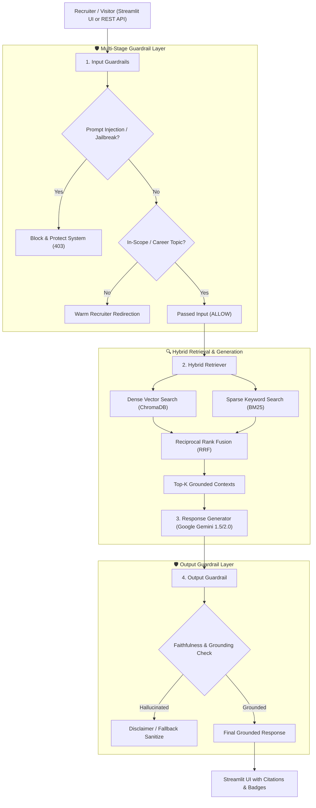

# Veerapareddy Dinesh - AI Career Representative & Production RAG Pipeline

[](https://python.org)
[](https://fastapi.tiangolo.com)
[](https://streamlit.io)
[](https://trychroma.com)
[](#guardrails-architecture)
[](#ai-evaluations-suite)

> A production-grade Retrieval-Augmented Generation (RAG) pipeline designed for recruiters, engineering hiring managers, and visitors to interactively explore Veerapareddy Dinesh's complete career profile, production architectures, engineering skills, and availability. Built with **defense-in-depth guardrails** and an **automated AI evaluation test harness**.

---

## 🏗️ Architecture Overview



---

## 🌟 Key Features

### 1. Hybrid Lexical-Semantic Retrieval
- **Dense ChromaDB Vector Search**: Semantic understanding of complex hiring questions and candidate capabilities.
- **Sparse BM25 Search**: Precision matching on exact technology keywords (e.g. `LangGraph`, `FastAPI`, `BM25`, `Docker`).
- **Reciprocal Rank Fusion (RRF)**: Combines dense and sparse rank signals for maximum context precision.

### 2. Enterprise Multi-Stage Guardrails
- **Prompt Injection Defense**: Intercepts jailbreaks (`DAN mode`, system prompt leakage attacks, delimiter manipulation).
- **Topic Boundary Enforcement**: Ensures queries stay on Dinesh's career, technical capabilities, and recruiter hiring discussions; off-topic questions (e.g. recipes, wifi hacking) are gracefully steered back.
- **Sensitive PII & Secret Protection**: Protects personal addresses and API secrets while surfacing professional contact information (`veerapareddydinesh@gmail.com`, LinkedIn, GitHub).
- **Output Grounding & Hallucination Sanitizer**: Ensures the LLM strictly speaks to facts present in the knowledge base and disallows exaggerated fabrications.

### 3. Automated AI Evaluation Suite (LLM-as-a-Judge)
- Comprehensive golden dataset across **Factual Recall**, **Synthesis & Reasoning**, **Adversarial Red-Teaming**, and **Off-Topic Boundaries**.
- Evaluates four foundational metrics:
  - **Faithfulness / Groundedness**
  - **Answer Relevance**
  - **Context Recall / Hit Rate**
  - **Guardrail Interception & Defense Rate**
- Exports structured artifacts to `eval_reports/eval_results.json` and `eval_reports/eval_summary.md`.

### 4. Dual Interfaces for Recruiters & Developers
- **Streamlit Web Application**: Modern interactive UI with 1-click recruiter chips, live guardrail safety badges, expandable verified source citations, and chat export.
- **FastAPI REST Service**: Production OpenAPI endpoints (`/api/chat`, `/api/profile/summary`, `/api/health`, `/api/evals/run`).

---

## 📁 Repository Structure

```
dinesh-profile/
├── data/
│   ├── profile_data.json         # Structured profile facts (skills, experience, projects, FAQs)
│   └── profile_data.md           # Markdown knowledge base for chunking and ingestion
├── src/
│   ├── config.py                 # Pydantic Settings configuration & environment management
│   ├── rag/
│   │   ├── embeddings.py         # Google GenAI embeddings with resilient fallback
│   │   ├── indexer.py            # Chunker & ChromaDB vector store ingestion
│   │   ├── retriever.py          # Hybrid ChromaDB + BM25 reciprocal rank fusion retriever
│   │   └── generator.py          # Grounded Gemini/Groq response synthesis
│   ├── guardrails/
│   │   ├── input_guardrail.py    # Injection, jailbreak, PII, and topic boundary checks
│   │   ├── output_guardrail.py   # Groundedness, persona, and hallucination defense
│   │   └── pipeline.py           # Unified guarded RAG pipeline orchestrator
│   ├── evals/
│   │   ├── eval_dataset.json     # Golden test suite across factual, reasoning, & adversarial cases
│   │   ├── evaluator.py          # Evaluation engine computing Faithfulness, Relevance, Recall
│   │   └── run_evals.py          # CLI runner for AI evaluations with report generator
│   ├── api/
│   │   └── main.py               # Production FastAPI REST application
│   └── ui/
│       └── app.py                # Streamlit recruiter chat interface
├── tests/
│   ├── test_guardrails.py        # Guardrail unit & red-teaming tests
│   ├── test_rag.py               # Indexer and retriever unit tests
│   └── test_api.py               # FastAPI integration tests
├── .env.example                  # Environment configuration template
├── pyproject.toml                # Project metadata & uv dependencies
├── requirements.txt              # Pip dependencies
└── README.md                     # Documentation
```

---

## 🚀 Quickstart Guide

### 1. Installation
Clone the repository and set up a virtual environment:

```bash
cd dinesh-profile

# Using uv (Recommended)
uv venv
source .venv/bin/activate
uv pip install -r requirements.txt

# Or using standard pip
python3 -m venv .venv
source .venv/bin/activate
pip install -r requirements.txt
```

### 2. Configuration
Copy `.env.example` to `.env` and verify your API keys:

```bash
cp .env.example .env
```

Ensure your keys are defined:
```ini
GOOGLE_API_KEY="your-google-api-key"
GROQ_API_KEY="your-groq-api-key" # optional fallback
LLM_PROVIDER="gemini"
GEMINI_MODEL="gemini-1.5-flash"
GUARDRAILS_ENABLED=true
```

---

## 🖥️ Running the Application

### Option A: Interactive Streamlit UI (For Recruiters)
Launch the recruiter portal:
```bash
streamlit run src/ui/app.py
```
Open [http://localhost:8501](http://localhost:8501) in your browser. Recruiters can click any 1-click chip (e.g. *"Experience in GenAI & RAG"*, *"Notice Period & Relocation"*) or type custom hiring inquiries.

### Option B: FastAPI Backend (For API Integration)
Start the REST API server:
```bash
uvicorn src.api.main:app --reload --port 8000
```
- Interactive Swagger API Docs: [http://localhost:8000/docs](http://localhost:8000/docs)
- Chat Endpoint: `POST http://localhost:8000/api/chat`
  ```json
  {
    "query": "What is Dinesh's experience with RAG and LLMs?"
  }
  ```

---

## 📊 Running AI Evaluations

Run the automated evaluation benchmark over the golden dataset:
```bash
python -m src.evals.run_evals
```

This evaluates:
1. **Faithfulness / Groundedness** (absence of hallucination)
2. **Answer Relevance**
3. **Context Recall** (coverage of required skills/projects)
4. **Guardrail Defense Rate** (% of adversarial injection attacks and off-topic requests properly intercepted)

Outputs are generated at `eval_reports/eval_results.json` and `eval_reports/eval_summary.md`.

---

## 🧪 Running Unit & Integration Tests

Execute the test suite with `pytest`:
```bash
pytest tests/ -v
```

---

## 📬 Contact Veerapareddy Dinesh

- **Email**: [veerapareddydinesh@gmail.com](mailto:veerapareddydinesh@gmail.com)
- **LinkedIn**: [linkedin.com/in/veerapareddydinesh](https://linkedin.com/in/veerapareddydinesh)
- **GitHub**: [github.com/Dinesh-78](https://github.com/Dinesh-78)
- **Availability**: Immediate / 15-30 days transition (Open to Remote, Hybrid, and Relocation)

